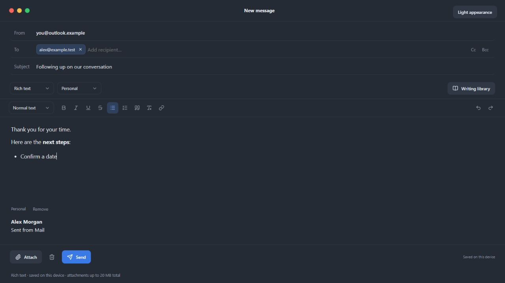
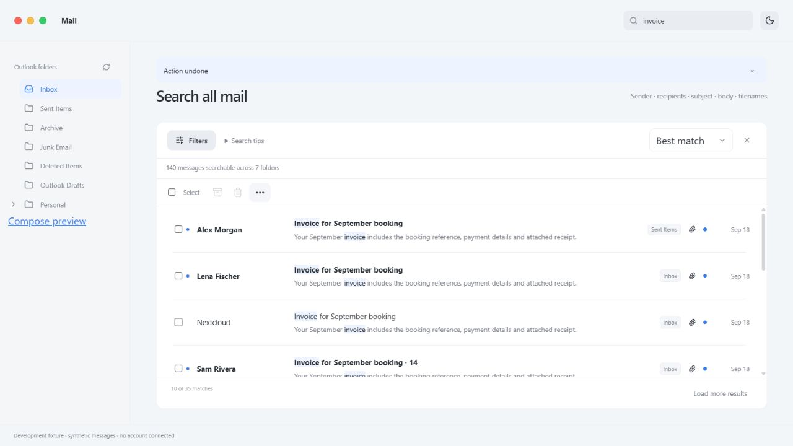

# Mail

A personal desktop mail client for **CachyOS and GNOME**, with a clean WhiteSur-inspired interface, local mailbox-wide search and rich writing tools.

**Personal alpha · Linux desktop · React + Rust / Tauri**

The connected client currently supports **one personal Outlook account**. Gmail, work IMAP, Google Calendar and Nextcloud are planned integrations. Development happens on Windows 11 with WSL2; native testing happens on CachyOS.



*Development preview with synthetic email. The editor supports formatted text, signatures, templates and snippets in both light and dark appearances.*

## What works today

- **Outlook mail:** secure browser sign-in, real folders/subfolders, Important/Other using Outlook's Focused classification, indexed conversation history, Reply all and Forward.
- **Search across mail:** sender and recipients, subjects, bodies and attachment names across indexed folders, with ranked results, snippets, phrases, Boolean operators, date/folder filters and local spelling suggestions.
- **Rich writing:** formatting, headings, lists, quotes, safe links and undo/redo, plus a plain-text alternative. Account-specific signatures, reusable templates and snippets are saved locally.
- **Mail actions:** archive, move to Deleted Items, folder moves, read/unread and moving into/out of Junk. Individual or bulk actions support selections of up to 100 and guarded session Undo.
- **Drafts and files:** autosaved local drafts, recipient chips with locally derived contact suggestions, native file picking/drop, upload progress and up to 20 MB total in 20 outgoing attachments. Provider limits still apply.
- **Reading and navigation:** sandboxed formatted email, images loaded on request, separate file downloads, previous/next messages and session restoration of folders, loaded pages and scroll position.
- **Desktop behavior:** system/light/dark appearance, left window controls, separate compose windows, close-to-background, single-instance reopening and explicit Quit. Synchronization continues while the process is running.

The current appearance uses a polished opaque fallback. Compositor blur, OS autostart and desktop notifications are not implemented yet.

## Search that goes beyond the loaded inbox



*Search preview with synthetic data. Results show matching text and their source folder; mail actions include Undo.*

The initial scan walks each folder's message pages, then establishes incremental change tracking. Saved messages remain searchable offline. Indexing progress, Outlook's reported folder-item count and incomplete coverage stay visible. **Rescan entire mailbox** restarts the scan without clearing saved mail or drafts.

Examples:

```text
from:alex invoice has:attachment
"booking reference"
(invoice OR receipt) -folder:junk
person:alex@example.com after:2026-09-01 before:2026-10-01
emails from alex about invoice last month
unread emails from Alex Morgan or Sam Jones without attachments
emails between September 1 and September 30
messages file named invoice.pdf
```

Search runs locally, with **no AI calls or Plus usage**. Familiar English requests combine full names, sender alternatives/exclusions, message state, folders, filenames and date ranges into visible filters. Quoted text and explicit filters stay literal. Attachment filenames are indexed; text inside attached files and OCR are not. There is no 1,000-message search-result cap. Outlook's folder-item total can include non-email items, so it is not an exact email count.

[Search syntax, indexing coverage and cache controls →](docs/search.md)

## Run on CachyOS

You need Node.js 22.12 or newer, npm, Rust/Cargo, the Linux desktop build dependencies and an unlocked GNOME Keyring. Follow the [Linux setup guide](docs/linux-desktop.md) for the dependency installation command and native checks.

```sh
git clone https://github.com/Arianic/mailclient.git
cd mailclient
npm ci
npm run desktop:dev
```

To connect Outlook, create your own Microsoft app registration and follow the [Outlook setup guide](docs/outlook-setup.md). No client secret is needed.

| Permission | Purpose |
| --- | --- |
| Mail.Read | Read and locally index the mailbox |
| Mail.Send | Submit messages after an explicit Send action |
| Mail.ReadWrite | Mail actions, read-status sync and the larger attachment upload path |

Initial sign-in also uses User.Read and offline_access. Sending and mail-management permissions are enabled separately in Settings. Outlook-created drafts are currently a read-only folder view; **Local drafts** contains messages written in this client.

### Update an existing checkout

Quit through **Settings → Quit Mail**, then stop the development command with Ctrl+C. In the existing repository folder:

```sh
git pull --ff-only
npm ci
npm run desktop:dev
```

Settings, local drafts and credentials are retained. Updates can migrate local databases and schedule a fresh index scan. This project currently runs from source; installable packages and automatic updates are later work.

## Writing tools

Open **Writing library** in the composer to create and manage signatures, templates and snippets. Choose an account default signature, create a template from your current authored message, or insert a snippet at the cursor. Replacing existing writing with a template asks first and preserves recipients, attachments and the selected signature.

Drafts keep their own signature snapshot, so later library edits do not silently rewrite existing drafts. New replies keep quoted history separate and place the signature before it. Existing plain-text drafts remain compatible.

Sending has a **five-second Undo Send** delay. An accepted send is reported as submitted to Outlook, not confirmed delivery. Interrupted or uncertain submissions are held for review and are never automatically replayed.

[Writing guide →](docs/writing.md)

## Local data and privacy

- Refresh credentials stay in **GNOME Keyring**; no plaintext token-file fallback is used.
- Indexed mail and filename metadata use `outlook-mail.sqlite`. Drafts, attachment copies, send states and writing libraries use the separate `outlook-drafts.sqlite`.
- These local mail databases are **not encrypted at rest**. The Linux app-data directory is owner-only. Settings provides pause, rescan and account-scoped cache clearing; local drafts have their own discard action.
- Indexing does not automatically download attachment files or remote images. Loading remote images can disclose that the message was opened; permission is currently per message.
- Credentials, mail and writing libraries stay out of appearance/settings exports and the prototype's sample-data store.
- Received HTML is sanitized and isolated in a sandboxed frame. Outgoing rich text is independently restricted in the frontend and Rust backend.

No cloud AI service is connected. The project's future AI boundary excludes work mail and derived work content; eligible personal bodies would require an explicit sharing action. Junk controls currently move messages, rather than training provider spam filtering or blocking senders.

## Development and verification

```sh
npm ci
npm run test
npm run build
```

For a browser-only design preview, run `npm run dev`. Normal browser views use synthetic sample mail and never send. The development-only `/?outlookPreview` reader and `/?outlookPreview=compose&outlookCompose=preview-draft` composer fixtures exercise the connected interface with synthetic data. These fixtures are excluded from production builds.

The latest search checkpoint passed **120 frontend tests and 49 Rust tests**, plus the production frontend and Linux executable builds. Checks cover phrase interpretation, search pagination and recovery, private-data boundaries, draft persistence, HTML handling, send-state protections and writing tools. Both themes were checked with synthetic browser data; the preceding writing milestone also passed an isolated software-rendered WSLg startup. See [native development checks](docs/linux-desktop.md) and [development checkpoints](outputs/prototype-status.md).

CachyOS/GNOME interaction checks and real-account round trips remain necessary for new features. Automated tests never send actual mail. WSLg startup and browser previews do not establish full GNOME compatibility.

## Next milestones

1. GNOME notifications, quiet autostart and suspend/resume behavior.
2. Gmail and work IMAP/SMTP, then a real unified inbox across accounts.
3. Google Calendar synchronization and Nextcloud attachment sharing.
4. Scheduled sending, From aliases, provider draft editing and configurable cache retention.
5. Optional AI with explicit privacy/usage limits, followed by rules, shortcuts, custom themes and permission-controlled extensions.

These are planned capabilities. The browser's sample calendar and account colors do not represent connected calendar, Gmail or work IMAP integrations.

[Full project plan →](outputs/mail-client-action-plan.md)
