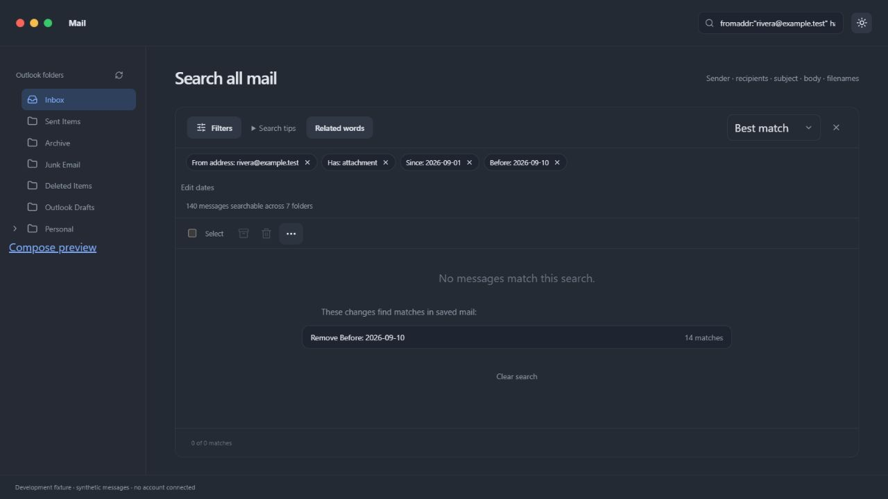

# Search all mail

The top search field searches the connected personal Outlook mailbox across discovered folders, independently of the folder or Important/Other view you were browsing. It searches sender names/addresses, To/Cc/Bcc recipients, subjects, visible body text and attachment filenames. Sent Items, Archive, Junk, Deleted Items, server Drafts and discovered custom subfolders are included. Client Local drafts are separate. Gmail and work IMAP are not connected yet.

## Everyday searches

- `invoice` matches words beginning with invoice; matches in subjects and senders receive more weight than body matches.
- `"booking reference"` matches a token phrase. Searches ignore common Latin accents and letter case; punctuation follows the local full-text tokenizer.
- `from:alex invoice has:attachment` combines filters.
- `(invoice OR receipt) -folder:junk` combines alternatives and exclusions.
- `person:alex@example.com after:2026-09-01 before:2026-10-01` searches that person in sender and recipient fields over September.
- `filename:receipt.pdf` searches attachment names, not text inside files.
- `emails from alex about invoice last month` translates common phrases into explicit filters. The interpreted query is displayed so you can inspect or edit it. This is deterministic interpretation, not a general AI understanding claim.

Words combine with AND by default. Use uppercase `AND`, `OR`, `NOT`, parentheses, or a leading minus. Quotes preserve phrases. Use the Filters panel if you prefer fields and date pickers. Best match, Newest and Oldest sorting are available. Results show body snippets and folder names; Load more results continues beyond the first page. There is no 1,000-message search-result cap. Single-word searches with no results can offer local spelling suggestions; they never silently replace your query.

Supported fields: `from:`, `to:`, `cc:`, `bcc:`, `person:`, `subject:`, `body:`, `filename:`, `folder:` (alias `in:`), `after:`, `before:`, `on:`, `is:unread`, `is:read`, `is:important`, `is:other`, `has:attachment`. `me` in a people field resolves to the connected account address. Folder filters match folder-name text, not an entire subtree or full path; duplicate names can match several folders. Dates use local calendar days in YYYY-MM-DD form; after is inclusive and before exclusive. Unknown fields and malformed dates/operators show an error rather than silently ignoring the filter. To search literal text containing a colon, use a supported field with a quoted value, e.g. `body:"https://example.com"`.

## Familiar English requests

You can combine people, dates, message state, folders and attachments in one request. Leading “find”, “show me”, “search for”, or “look for” can introduce a request, with or without “emails/messages”. The client displays the resulting filters under **Searching:**; inspect them when a request is ambiguous. These rules run locally and do not contact AI or use Plus allowance.

| Request | Meaning |
| --- | --- |
| `show me unread emails from Alex Morgan last month` | Unread, full sender name, previous calendar month |
| `emails from Alex or Sam with attachments` | Either sender, with the attachment requirement applied to both |
| `emails not from Alex about invoices` | Invoice keywords, excluding that sender |
| `messages involving Alex Morgan without attachments` | Person in sender/To/Cc/Bcc, without attachments |
| `emails I sent to Alex in Sent Items` | From the connected account, addressed to Alex, folder-name filter |
| `emails subject contains quarterly report` | Both words in the subject; use quotes for an exact phrase |
| `messages body contains "booking reference"` | Phrase in visible body text |
| `emails file named invoice.pdf` | Attachment filename, not attached-file content |
| `messages in folder "Travel 2025"` | Folder-name filter |
| `emails between September 1 and September 30` | Both dates included, current year when omitted |
| `emails since September 1 2025` | Inclusive start date |
| `emails until October 12 2026` | Includes October 12 |
| `emails older than 30 days` | Before the local date 30 days ago |
| `Could you dig up PDFs Alex sent last September, excluding anything about refunds?` | Attachment filename token PDF, sender, most recent September, exclude refund keywords |
| `Find hotel booking Alex sent me last December` | Topic words, sender, own primary address as recipient, most recent December |
| `emails from Alex or Sam but only with attachments` | Grouped people, attachment condition on both |
| `emails from Alex but not Sam` | From Alex, excluding Sam |

People clauses accept `from`, `received from`, `sent by`, `to`, `sent to`, `cc`, `bcc`, and `involving` (any sender/recipient). Multiword names become phrases. A name ends at the next recognized clause, `about`, `containing`, or Boolean connector; quote names containing reserved words, such as `from "May Last"`. Separate keywords from a sender with `about`: `from Alex about invoices`. `me` resolves to the connected account's primary address; this does not infer other sending aliases. Lowercase `or` joins people alternatives into a group. Uppercase `OR` retains the explicit query grammar and precedence. `not`, `except` and `excluding` can negate a recognized clause.

`unread emails`, `read emails`, `important emails` and `other emails` set message state/classification. `unread` and `important` also work as standalone qualifiers; `that are read/unread` and `marked as read/unread` work after another clause. Important/Other remains Outlook's classification. `with attachments`, `with an attachment`, `without attachments` and `with no attachments` set attachment presence. Subject/body requests apply each unquoted word to that field; a quoted value stays a phrase. `attachment named`, `file named`, and `filename contains` search filename tokens. Built-in folder shortcuts include `in inbox`, `in archive`, `in junk`, `in drafts`, `in Sent Items` and `in Deleted Items`; these use English folder-name matching. Use `in folder "Actual folder name"` for custom/localized folders.

Dates use the computer's local calendar:

- `today`, `yesterday`, `this week/month/year`, and `last week/month/year`. Weeks start Monday; “last month” is the whole previous calendar month. Current periods have an end boundary too.
- `last Friday` is the most recent Friday strictly before today; `this Friday` is Friday in the current Monday-Sunday week, even if still ahead.
- `last 14 days`, `past two weeks`, `previous 3 months`, and `past year`. Numbers one through ten or digits 1–999 are supported. Rolling day/week windows include today: “last 7 days” means today and the previous six local dates. Rolling month/year windows start at the corresponding date, clamped for shorter months, and end after today.
- `on October 12, 2026`, `on 12th October 2026`, `on 2026-10-12`, `in September 2025`, and `during 2025`. Written month names/abbreviations avoid numeric day/month ambiguity. An omitted year means the current year.
- `since`/`after` include the starting date; `before` excludes it. `until`/`through` include the named day or whole named month/year. `between DATE and DATE` includes both endpoints; repeat the month/year where needed. `older than N days/weeks/months/years` and `newer than N ...` use local date cutoffs, not exact elapsed hours.
- `the week before last` means the calendar week two weeks before this one. `last September` means the most recent whole September before the current month; in September itself, it uses the previous year.
- `in the last fortnight` means the last fourteen calendar dates, including today. `a couple of weeks` means two weeks; `a couple of weeks ago` or `a fortnight ago` selects the local date fourteen days ago. “A couple” is explained in the interpretation.
- `early September`, `mid September`, and `late September` use days 1–10, 11–20, and 21–month-end. `around Christmas last year` means December 22–28 of the previous year; `on Christmas 2025` selects December 25. Without a year, Christmas uses the current year; `last Christmas` uses the most recent Christmas strictly before today. `recently` means the last thirty calendar dates, including today. These choices are explained; **Edit dates** opens the selected range for correction.

Quotes and explicit filters are preserved, including spaces inside quoted values: `subject:"last month"`, `from:today`, and `"unread"` stay literal. Malformed quotation marks remain available to the native parser's error handling. Unsupported phrasing, ambiguous slash dates and invalid natural-language dates remain search words rather than guessed dates. Bare `May report` and `invoice 2025` also remain keywords. Leading polite requests such as “Could you please find me”, “look up” and “dig up” are recognised; common grammar typos such as “recieved from” and “with attachements” are corrected with a visible explanation. Other typos are not silently rewritten. `PDFs`, `PDF files`, and `PDF attachments` add attachment presence and the exact filename token `pdf`; they do not inspect file contents or guarantee MIME type. This remains a supported English grammar with defined date conventions, not unrestricted language understanding.

## Refine a search without starting over

The condition pills show the actual query. Removing a pill removes that whole condition: a sender alternative or negated group stays together, preserving Boolean meaning. **Edit dates** pre-fills the top-level date range; applying it replaces those top-level date conditions instead of adding a contradictory range. Dates inside manually grouped Boolean expressions stay intact; remove/edit that group explicitly. Removing the last condition keeps an all-saved-mail search, rather than switching to Important Inbox.

Name filters offer **Choose exact person** suggestions from the connected account's locally indexed mail. Up to eight recent address matches per name are shown for the first four person conditions, including exclusions. No person is chosen automatically. Selecting an address changes only that occurrence and uses exact address equality (`fromaddr:`, `toaddr:`, `ccaddr:`, `bccaddr:`, or `personaddr:`), preserving the other filters and groups. These exact fields are also accepted when typed; ordinary `from:` remains a text/prefix search. Suggestions are not a synchronized address book and may be incomplete while indexing.

**Related words** is optional and off initially. It uses a small shipped dictionary: hotel/accommodation/lodging, booking/reservation, invoice/bill/billing, refund/reimbursement, shipment/delivery/dispatch, receipt/proof of payment, itinerary/travel schedule, and ticket/boarding pass. For example, `hotel booking` can also match `accommodation reservation`. It expands up to four positive unquoted keywords into visible OR groups within the query's size limits. Phrases, field values and exclusions remain literal. The setting is remembered with the in-session search view; it does not download models or call any AI. This is curated wording expansion, not a semantic embedding index or general synonym service.

When no saved messages match, the client checks up to eight single-condition removals and offers only changes that produce matches, with their counts. It can also suggest up to three whole-query spelling corrections, checking up to three positive unquoted keyword words against the local vocabulary. Corrections preserve all other filters and quoted/negative terms and must produce matches before being offered. No choice is applied automatically. Counts refer to saved mail at the time of checking; incomplete coverage is flagged and new synchronization can change them. Multiple conflicting conditions may require more than one change; a lack of suggestions does not prove the server mailbox has no relevant message. Diagnostics return counts and queries, not message bodies, and enforce the connected account boundary.

All these features run locally with **no AI**, model downloads, embedding service, OCR or cloud processing. Search metadata, contact suggestions and counts stay out of appearance/settings exports. No new OAuth scope or mailbox rescan is needed for this search upgrade.

*Development preview with synthetic mail: removing the selected end-date condition finds fourteen matches while preserving the exact sender and other conditions.*

## Coverage, refresh and offline copies

The first launch builds a local index in the background. Search returns indexed mail immediately and shows its coverage. Older mail and attachment names can still be pending, so an early empty search is not evidence the mailbox contains no match. Large mailboxes can take time; checkpoints survive restarts. Indexing continues while the app runs, including when its main window is hidden. Closing/quitting the process or losing connectivity stops progress until it can resume.

The initial scan uses ordinary folder-message listing and follows every next-page URL, including empty intermediate pages, without a total-result limit. Page size is requested through the Prefer header. A separate delta baseline establishes change tracking after the full listing; later change pages do not discard older indexed history. Folder message changes use Microsoft's per-folder delta checkpoints. Visible lists also refresh periodically and after reconnect/focus; Refresh requests synchronization. Folder discovery is repeated periodically. No desktop push notifications or OS autostart are implemented yet. See [Microsoft's delta guidance](https://learn.microsoft.com/en-us/graph/delta-query-messages).

Saved message bodies can be opened offline, with an offline indicator. Images and attachment bytes are not cached by the search index; loading/downloading these still requires connectivity. Contact suggestions come from locally indexed mail addresses, not a synchronized contacts service. Conversation history uses messages already indexed, with a notice while more history is pending.

Settings → Personal Outlook → Mailbox search & offline copies provides Pause, Resume, Rescan entire mailbox and Clear cached mail. Rescan restarts every folder without deleting existing copies, drafts or credentials. The version-two index upgrade automatically schedules a full scan of older indexes and preserves an intentional pause. The status compares per-folder cached messages with Outlook’s reported item counts and flags incomplete coverage rather than claiming completion. Those provider counts can include non-email items, so the two numbers are not guaranteed to match exactly. Errors take precedence over completion text, and pending delta pages are counted as unfinished. Clearing removes this account's derived message index, filename metadata and contact suggestions and pauses indexing. It does not delete server mail, drafts or credentials. This first implementation indexes all discovered history rather than providing an age/size retention slider.

The cache is `outlook-mail.sqlite` in the app-data directory. It contains private mail and is **not encrypted at rest**; the Linux application directory is owner-only. Use operating-system disk protection as appropriate. Cache clearing is an application-level deletion, not a forensic secure erase. Credentials remain in GNOME Keyring, and neither mail cache nor credentials enter settings exports. Search sends nothing to ChatGPT or another AI service and consumes no Plus allowance.

## Current limits

Only the single connected personal Outlook account is supported. Folder listing has a 1,000-folders-per-level safety limit; Graph responses have an 8 MB limit and timeouts. An oversized response or provider error is shown as incomplete sync rather than complete coverage. File-name indexing follows body indexing and may take longer. Provider throttling/connectivity affect initial indexing. Attachment contents, online archive mailboxes, recoverable-items stores and Outlook-created draft editing are outside this version.

Development fixture results are synthetic; real mailbox synchronization, moves/Undo, native file dropping and larger-file delivery still need a CachyOS check with the user's account. Automated tests never send real email.
